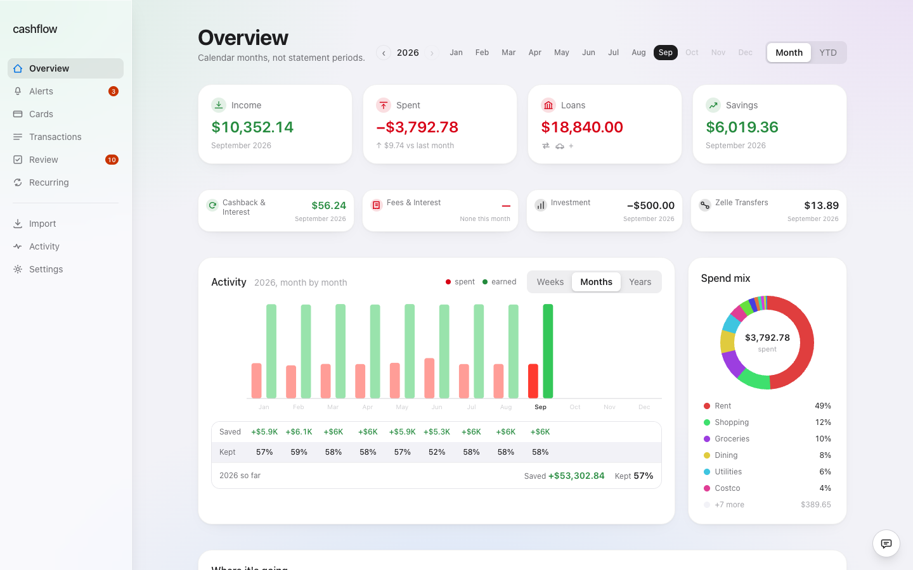
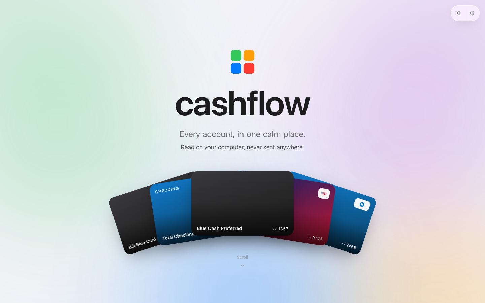

# cashflow

A household expense tracker that runs entirely on your own computer.
Upload your bank and card statements, check what was read, and see where
the money goes — by month, category, person and account. No bank logins,
no aggregators, no cloud: your statements and your database stay on your
machine.

**[Try the demo →](https://sujithsadineni.github.io/cashflow/)** — the real
app with an invented household, running in your browser. Nothing you do
there is saved.



## What it does

- **Statements in, transactions out.** PDF or CSV, years of them. PDFs from
  nine banks are read free on your own computer: Bank of America, Chase,
  American Express, Bilt, Robinhood, Barclays, SoFi, Apple Card and Zolve.
  Any other bank's PDF can be read by Claude, one file at a time, only when
  you ask (optional API key).
- **Review before anything is saved.** Parsed rows wait in a review queue
  with duplicate detection, and only what you approve reaches the ledger.
- **It checks its own work.** Every saved row is re-checked against the
  household's own history; the Review page says what looks wrong, why it
  matters and what approving changes, with one-click fixes and Undo. Fix a
  merchant once and later imports learn its name, type and category.
- **Every statement adds up.** Each statement's rows are checked against its
  printed opening and closing balances, to the cent, with a likely cause for
  any gap.
- **Every card payment traced** to the bank row it came from ("Paid by Chase
  checking"), or a note saying which statement is missing.
- **Where each purchase happened:** the town or "Online", read from the
  bank's line and filled in from your other visits when a store prints only
  a phone number. Each merchant has its own history card.
- **Overview.** Income, spend, loans and savings for any month or the year so
  far, an activity chart, and a category breakdown.
- **Cards.** Every account with its transactions, category totals and a
  statement calendar of uploaded, missing or not-due months.
- **Recurring bills,** found in your history, with countdowns and what was
  paid, missed or due each month.
- **Loans,** tracked by hand (a car loan, a 0% balance transfer with its
  promo end date read off the statement) with progress toward payoff.
- **Savings and investment balances** entered by hand, so money moved out of
  your accounts is still accounted for.
- **Zelle** payments sorted into sent, received and transfers between you.
- **History.** Every edit is recorded, from → to.
- **Daily backups** of the database and your statements to
  `~/cashflow-backups`, newest 30 kept.
- **Privacy mode** hides every amount with one click, for screenshots.
- **Three designs, light or dark:** a quiet ledger-paper *Classic*, a
  colourful *Vivid*, and *Glass*, Apple-style, which the demo opens in.
  Every page fits a phone.



## Set it up

You need **Node 22+** and **PostgreSQL 15+** (developed on Node 26 and
PostgreSQL 17). Pick whichever way suits you — all three end in the same place.

### With Claude Code

```sh
git clone https://github.com/sujithsadineni/cashflow.git && cd cashflow
claude
```

Then ask:

> Set this project up locally by following the "By hand" section of
> README.md, and tell me when the app is running.

Claude Code reads `CLAUDE.md` → `AGENTS.md` for the project's rules, so it
knows the conventions before it changes anything.

### With Codex

```sh
git clone https://github.com/sujithsadineni/cashflow.git && cd cashflow
codex
```

Ask the same thing. Codex reads `AGENTS.md` directly.

### By hand

1. **Database** — create an empty one:

   ```sh
   createdb cashflow
   ```

2. **API** (port 4000) — `npm run migrate` builds the schema from `db/`, and
   later applies only new migrations (the API won't start behind):

   ```sh
   cd api
   cp .env.example .env      # edit DATABASE_URL if your Postgres needs a user/password
   npm install
   npm run migrate
   npm run dev
   ```

3. **Web** (port 5173), in a second terminal:

   ```sh
   cd web
   npm install
   npm run dev
   ```

4. Open **http://localhost:5173**, add yourself under Settings → People, and
   upload a statement under Import.

Uploaded statements are kept in `data/statements/` at the repo root, which is
git-ignored.

### Optional: read any bank's PDFs with Claude

Without an API key, CSV files and PDFs from **Bank of America, Chase,
American Express, Bilt, Robinhood, Barclays, SoFi, Apple Card and Zolve** are
read entirely on your machine — free. For any other bank's PDF, cashflow can
ask Claude to read the transaction pages:

1. Create an API key at **[console.anthropic.com](https://console.anthropic.com)**
   → API Keys (the account needs a little prepaid credit).
2. Put it in `api/.env` — never anywhere else; that file is git-ignored:

   ```sh
   ANTHROPIC_API_KEY=your-key-here
   ```

3. Restart the API (`Ctrl+C`, then `npm run dev` in `api/`) — it reads `.env`
   only at startup.
4. On the **Import** page, drop the statement in as usual: it's always read
   free first. When the free reader can't handle it, a **Read with Claude**
   button appears for that one file — nothing is sent until you click it.
   Only the pages with transactions or totals are sent (terms and conditions
   are skipped locally), and it typically costs a few cents. Every parsed row
   still waits for your review before it's saved.

Only Claude (Anthropic) is supported today; OpenAI/GPT is not.

## Tests

```sh
cd api && npm test
cd web && npm test
node --test scripts/
```

## The demo

The GitHub Pages demo has no server. `api/demo/seed.mjs` creates an
invented household in a separate `cashflow_demo` database,
`api/demo/record.mjs` drives the real app in headless Chrome and saves every
API response, and `npm run build:demo` builds a version of the web app that
replays those responses. It opens in the Glass design with its intro, and its
"today" is fixed at the household's last day (Sep 30, 2026), so it never
lands on a month with no data. Search and filters work: the demo filters the
recorded rows itself. Rebuild all of it with:

```sh
sh api/demo/rebuild.sh     # needs Postgres and Google Chrome; never touches `cashflow`
cd web && npm run build:demo
```

## Contributing

Read `AGENTS.md` first — especially the money rules. Turn on the pre-commit
hook once per clone; it blocks statements, `.env` files and anything that
looks like a card number or secret:

```sh
git config core.hooksPath .githooks
```

How the pieces fit: [`guide/ARCHITECTURE.md`](guide/ARCHITECTURE.md). Why
things are the way they are: [`guide/DESIGN-NOTES.md`](guide/DESIGN-NOTES.md).

## License

[MIT](LICENSE)
